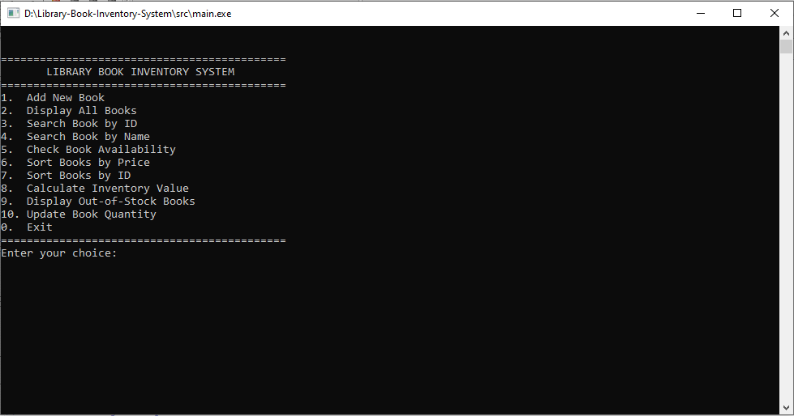
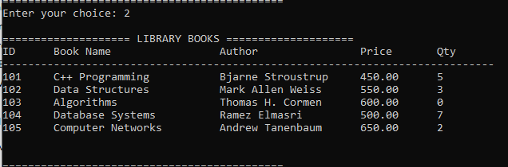
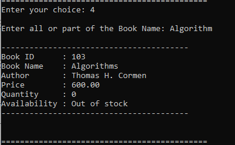

# Program Screenshots

Add screenshots captured from your own running program here, such as:

- `main-menu.png`
- `book-list.png`
- `search-result.png`
<!-- - `inventory-summary.png` -->

<!-- ## Project Screenshots -->

### Main Menu

### Book List

### Search Result

<!-- ### Inventory Summary
 -->
